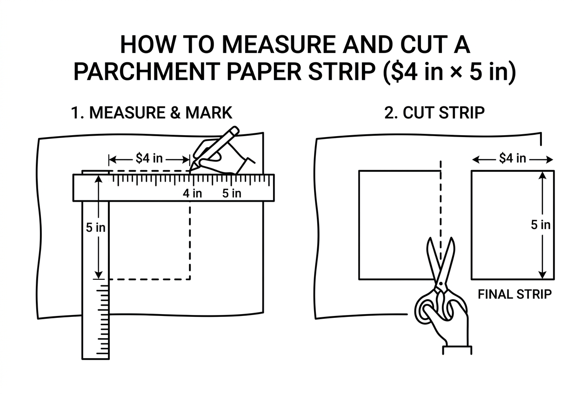

# Parchment Paper Box Divider

**Dimensions:** 4" (L) x 4" (W) x 2.5" (Depth)

## How We Calculated 4" x 5"
* **Width (4"):** Your box is exactly 4 inches wide and 4 inches long. The divider needs to stretch perfectly from edge to edge to fit snugly, so the width of the paper remains 4 inches.
* **Height (5"):** Your box is 2.5 inches deep. Parchment paper is too flimsy to stand up on its own. To give it the rigidity of cardboard, we double its thickness by folding it in half. **2.5 inches (depth) × 2 = 5 inches tall.** By cutting a 5-inch tall strip and folding it in half, you create a sturdy, double-thick 2.5-inch tall divider with a clean, folded top edge.

---

## Step 1: Measure and Cut
Cut two strips of parchment paper. Each strip needs to measure **4 inches wide** and **5 inches tall**.

## Step 2: Fold in Half
Fold both strips in half horizontally (bringing the top edge down to the bottom edge). Crease the fold firmly. 
*Note: You now have two double-thick strips measuring 4 inches wide and 2.5 inches tall. The folded edge will be the clean top edge of your divider.*

## Step 3: Cut the Slits
On both folded strips, measure to the exact center (the 2-inch mark). Using scissors, cut a vertical slit starting from the bottom (open) edge, going exactly **halfway up** (1.25 inches). Do this for both strips.

## Step 4: Interlock the Strips
Hold one strip right-side up, and flip the other strip upside down. Slide them together at their slits until the top and bottom edges are perfectly flush. They will lock together to form a cross shape.

## Step 5: Insert into the Box
Carefully lower your completed parchment cross into your 4x4 inch box. The divider will stand upright, giving you four perfectly equal 2x2 inch compartments.

> 